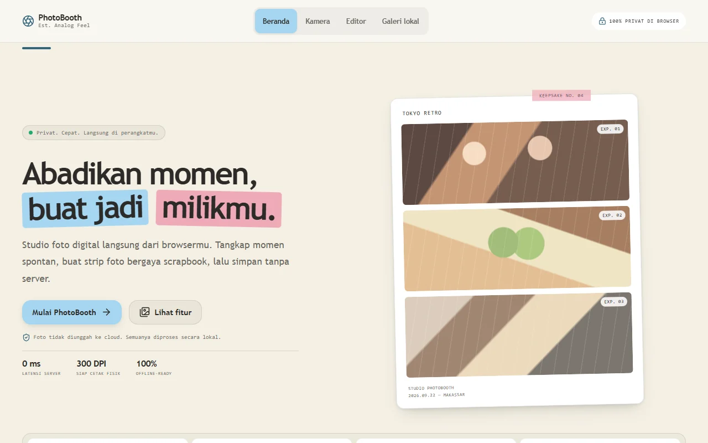

# PhotoBooth Studio

> [!NOTE]
> **100% Client-Side & Private:** Foto diambil, diproses dengan shader film 35mm, dan diekspor (300 DPI) sepenuhnya di browser via WebGL + IndexedDB tanpa upload ke server.

[](https://photobooth-neon-alpha.vercel.app/)




### Fitur & Verifikasi Lokal

- **Live Camera & Shader Studio** — Filter film analog, cropper margin frame kustom, stiker, serta galeri lokal IndexedDB dengan PWA offline shell.
- **Zero Secrets Needed** — Statis murni (`dist/`), siap deploy langsung ke Vercel atau cPanel (`.htaccess` SPA fallback).

```bash
npm install && npm run dev        # lokal (camera requires localhost / https://)
npm run verify                    # unit tests + typecheck + build + Playwright E2E
```

Lisensi pihak ketiga tercantum di [`THIRD_PARTY_NOTICES.md`](THIRD_PARTY_NOTICES.md).
